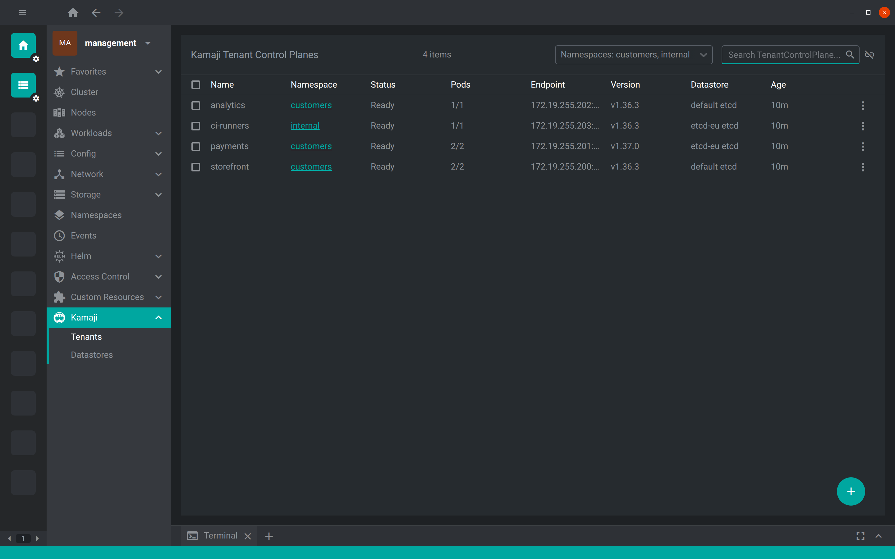
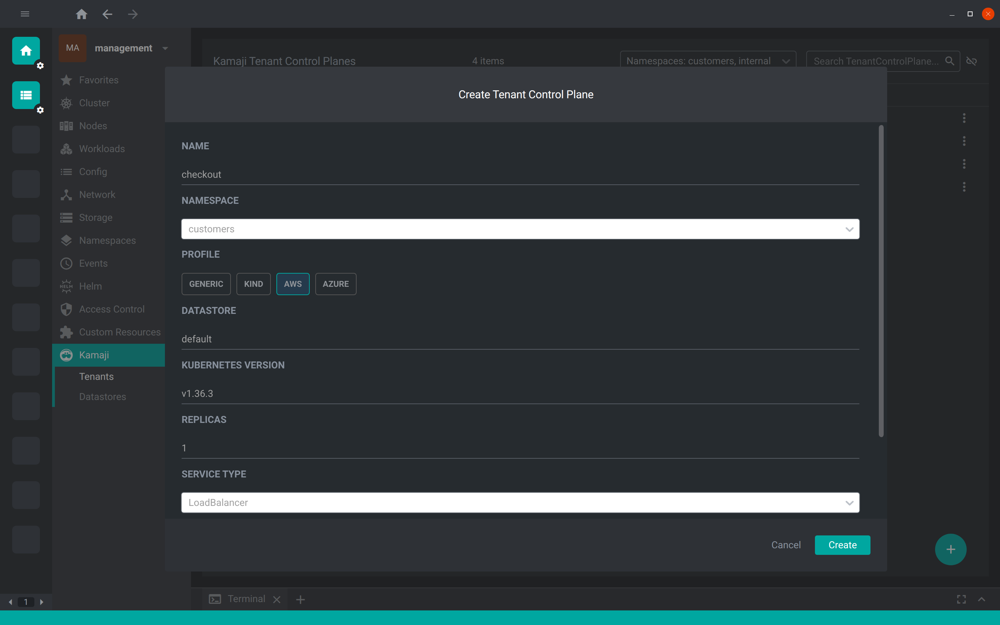
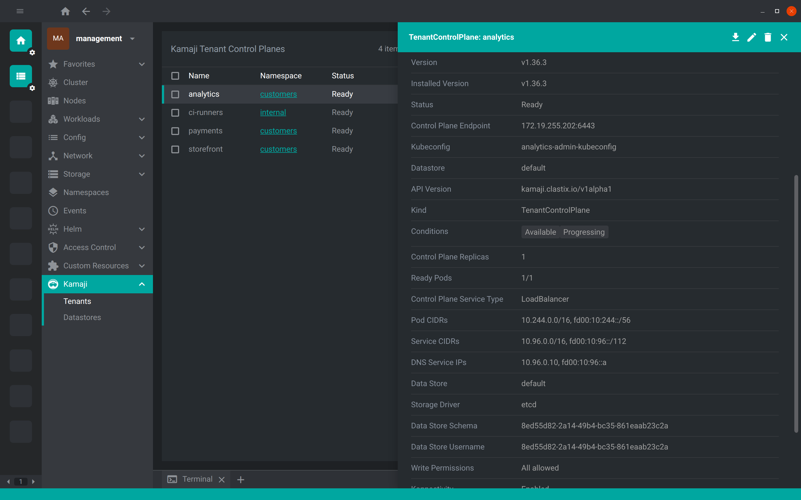
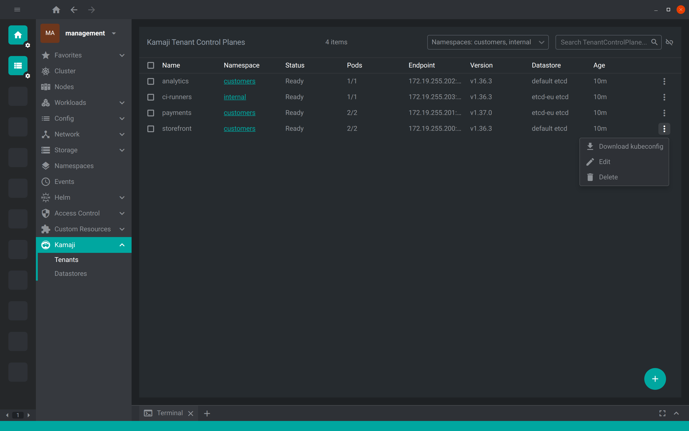
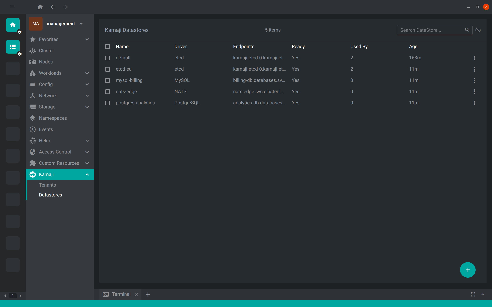
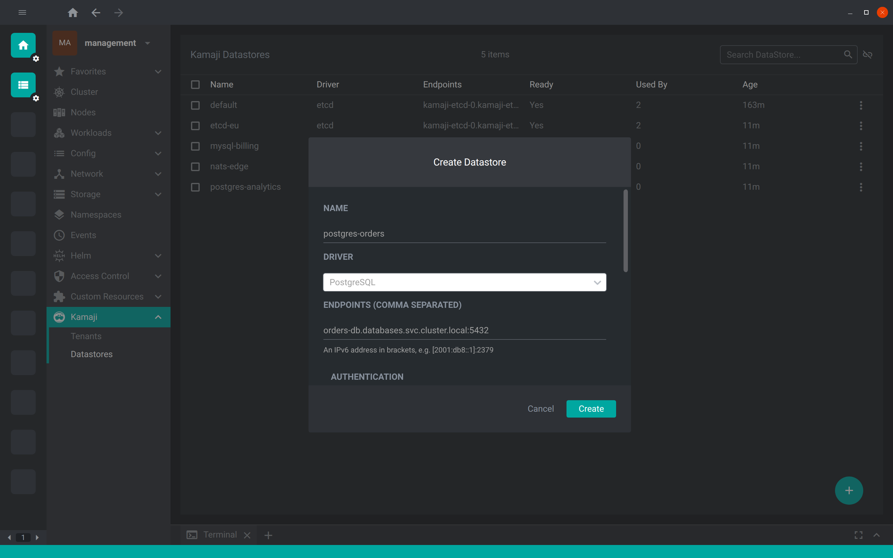
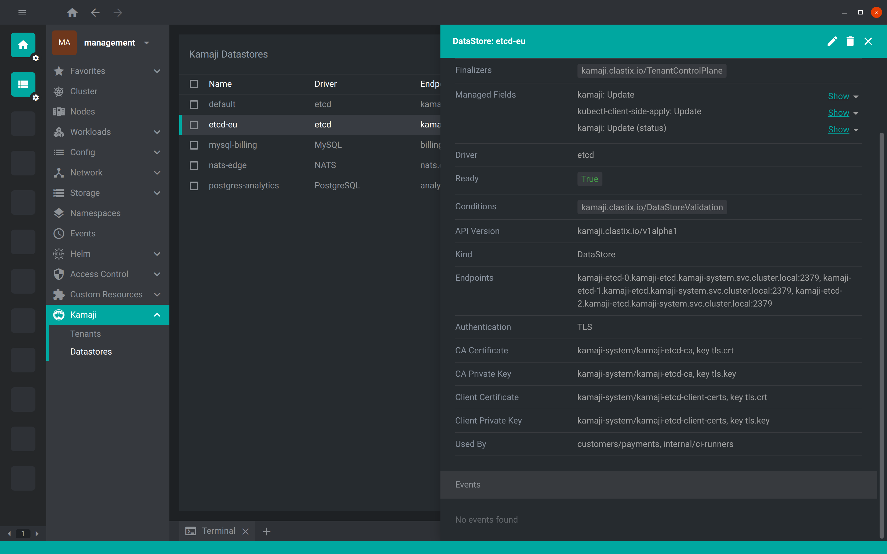

# @freelensapp/kamaji-extension

[](https://freelens.app)
[](https://github.com/freelensapp/freelens-kamaji-extension)
[](https://github.com/freelensapp/freelens-kamaji-extension)
[](https://github.com/freelensapp/freelens-kamaji-extension/actions/workflows/integration-tests.yaml)
[](https://www.npmjs.com/package/@freelensapp/kamaji-extension)

Freelens extension for [Kamaji](https://kamaji.clastix.io), which runs the
control planes of tenant Kubernetes clusters as pods of a management cluster.

The extension adds a **Kamaji** entry to the cluster sidebar, with two pages:
**Tenants**, the Tenant Control Planes of the namespaces that the namespace
filter selects, and **Datastores**, the DataStores of the cluster that hold
their state, of every driver of Kamaji: etcd, PostgreSQL, MySQL and NATS.
Each page creates its objects from a form, the menu of a row edits or deletes
one, and the details show what Kamaji reports about it. A tenant's menu also
downloads its admin kubeconfig, to open the tenant cluster in Freelens. The
forms follow the CRDs of Kamaji 26.10.5-edge, and say what is wrong with a
field before Kamaji refuses it.

[Video Demo](https://github.com/user-attachments/assets/5a0872b6-e70e-418f-a398-8c3ffa147d24)

## Requirements

- Freelens 2.0.0 or a later 2.x (extension API v2). Freelens 1.x needs
  version 1.0.0 of the extension.
- [Kamaji](https://kamaji.clastix.io) on the cluster, with its CRDs
  (`kamaji.clastix.io/v1alpha1`). On a cluster without them, the pages of the
  extension say that Kamaji was not detected.

> **Note**: Tested on kind, with Kamaji 26.10.5-edge. Feedback on other cluster
> types is welcome.

## Features

### Tenants



For each Tenant Control Plane of the selected namespaces:

- its name and namespace
- its status, as Kamaji reports it
- its ready pods
- the endpoint of its API server
- its Kubernetes version and its datastore

### Create a tenant



- **Name**, namespace, datastore, replicas and **Kubernetes version**, up to
  v1.37, the newest minor that Kamaji 26.10.5-edge accepts
- **Provider presets**: Generic, kind, AWS (NLB) and Azure (internal load
  balancer), which fill in the annotations of the Service of the control plane
- **Service type**: LoadBalancer, ClusterIP or NodePort
- **Advanced section**: the API and Konnectivity ports, the API and advertise
  addresses, the Service and Pod CIDRs (one, or two of different families for
  a dual-stack tenant), the DNS Service IPs (which Kamaji computes when left
  empty), the IP family policy and families of the Service, node ports for a
  load balancer, a headless Service, certificate SANs, admission controllers,
  the annotations and labels of the Service, and the node selector of the
  Deployment
- **Edit YAML**: the tenant as YAML, filled in from the form and applied as
  it is, for what the form does not expose

### Tenant details



- status, Kubernetes version and endpoint, which Freelens shows from the CRD
  above the panel; for a user who may not list CRDs, the panel shows them
- replicas and ready pods
- the conditions of the Deployment of the control plane
- the type of the Service of the control plane, and its IP family policy and
  families when the tenant sets them
- the Pod and Service CIDRs, and the DNS Service IPs
- the datastore, with its driver, the schema and user of the tenant in it,
  and the writes to it that the API server of the tenant refuses
- whether Konnectivity is enabled

### Download the kubeconfig of a tenant



**Download kubeconfig** in the menu of a tenant saves its admin kubeconfig.
Saved in a folder of Preferences > Kubernetes > Kubeconfig Syncs, it adds the
tenant cluster to the catalog of Freelens.

### Datastores



For each DataStore:

- its name, driver and endpoints
- whether Kamaji validated it
- the tenants that use it

### Create a datastore



- **etcd**, with TLS: the certificate authority with its private key, and a
  client certificate. The form proposes the etcd that the chart of Kamaji
  deploys.
- **PostgreSQL**, **MySQL** and **NATS**, with basic auth, TLS or both
- every value from a key of a Secret, with the key of each value in its own
  field, as the samples of Kamaji name them differently from one datastore to
  another

### Datastore details



- driver, whether Kamaji validated it and its conditions, which Freelens shows
  from the CRD above the panel; for a user who may not list CRDs, the panel
  shows the driver and whether Kamaji validated it
- endpoints
- how Kamaji authenticates to it, and where each value of its TLS
  configuration and basic auth comes from: inline, or a key of a Secret. The
  values themselves are never shown.
- the tenants that use it

## Install

Open Freelens and go to Extensions (`ctrl`+`shift`+`E` or
`cmd`+`shift`+`E`). The field at the top takes a package name, the URL of a
tarball, or the path to a tarball or a directory.

### From the registry

Enter `@freelensapp/kamaji-extension` and press Install.

Alternatively, open the following URL in the browser to install directly:

[freelens://app/extensions/install/%40freelensapp%2Fkamaji-extension](freelens://app/extensions/install/%40freelensapp%2Fkamaji-extension)

### From a release tarball

Each [release](https://github.com/freelensapp/freelens-kamaji-extension/releases)
has the extension as `freelensapp-kamaji-extension-<version>.tgz`, and from
2.0.0 on its checksum in `freelensapp-kamaji-extension-<version>.tgz.sha256`.
Use a release whose major version matches your Freelens version, 1.0.0 for
Freelens 1.x.

- Enter the URL of the `.tgz` asset and press Install. Freelens downloads the
  `.tgz.sha256` next to it and checks the tarball against it.
- Or download both files into one directory and enter the path to the `.tgz`,
  or drop the `.tgz` on the Freelens window. Freelens checks it against the
  `.tgz.sha256` next to it.

### From a directory

Build the extension (see below), then enter the path to your checkout, the
directory with `package.json`, and press Install. Freelens runs the extension
from that directory, from the files in `dist/`, and lists it as unverified.
This is how you work on the extension: see
[Development loop](#development-loop).

## Build from the source

### Prerequisites

Use [NVM](https://github.com/nvm-sh/nvm),
[mise-en-place](https://mise.jdx.dev/), or
[windows-nvm](https://github.com/coreybutler/nvm-windows) to install the
Node.js version in `.nvmrc`.

From the root of this repository:

```sh
nvm install
# or
mise install
# or
winget install CoreyButler.NVMforWindows
nvm install "$(cat .nvmrc)"
nvm use "$(cat .nvmrc)"
```

Install pnpm:

```sh
corepack install
# or
curl -fsSL https://get.pnpm.io/install.sh | sh -
# or
winget install pnpm.pnpm
```

### Build extension

```sh
pnpm install
pnpm build
```

The extension is built into `dist/`. To pack it into a tarball:

```sh
pnpm pack
```

One script to bump the prerelease version, build and pack the extension for
testing:

```sh
pnpm pack:dev
```

The tarball is placed in the current directory. Install it as described in
[From a release tarball](#from-a-release-tarball).

### Development loop

Install the extension from your checkout once, as described in
[From a directory](#from-a-directory), then run:

```sh
pnpm dev
```

It rebuilds the extension whenever a source file changes, and Freelens
reloads the extension after each rebuild, without a restart and without
packing. Stop it with `ctrl`+`C`.

Neither `pnpm build` nor `pnpm dev` type-checks; run `pnpm type:check` for
that. A change to `main` or `renderer` in `package.json` needs Freelens
restarted once.

To check the extension in Freelens with an AI agent, see "Checking the
Extension in Freelens Dev" in [AGENTS.md](AGENTS.md).

### Check the code

```sh
pnpm type:check
pnpm test:unit
pnpm lint:check
pnpm knip:check
```

and, for the formats that Biome does not cover:

```sh
pnpm trunk:check
```

### Integration tests

The integration tests drive Freelens dev, started from a
[freelensapp/freelens](https://github.com/freelensapp/freelens) checkout,
against a [kind](https://kind.sigs.k8s.io/) cluster. In the Freelens checkout:

```sh
pnpm dev
```

Freelens dev lists no cluster until a kubeconfig is added in Preferences >
Kubernetes > Kubeconfig Syncs. Add one with the kind cluster, for example:

```sh
kubectl config view --minify --flatten --context kind-kind > ~/kind-kind.kubeconfig
```

Then, with the kind cluster running, in the extension repository:

```sh
pnpm build
pnpm test:integration
```

The tests install the checkout in place, replacing any other installation of
the extension in Freelens dev. They install the CRDs of Kamaji 26.10.5-edge
and test objects, and delete them afterwards, with every Tenant Control Plane
and DataStore on the cluster and the namespaces `kamaji-tenants`, `kamaji-dev`
and `kamaji-system`: use a kind cluster with nothing worth keeping, without
Kamaji itself. Without Freelens dev or the cluster the tests are skipped.

Optional variables:

- `TEST_KIND_CLUSTER_NAME`: the kind cluster, `kind` by default, used
  through the context `kind-<name>`.
- `FREELENS_CDP_URL`: the CDP endpoint of Freelens dev,
  `http://127.0.0.1:9223` by default.
- `FREELENS_MAIN_LOG`: a log of the main process to check for errors, such
  as its `lens.log`. Without it only the renderer's errors are checked.

### Testing the extension with unpublished Freelens

In the Freelens working repository:

```sh
rm -f *.tgz
pnpm i
pnpm build
pnpm pack -r
```

Then in the extension repository:

```sh
echo "overrides:" >> pnpm-workspace.yaml
for i in ../freelens/*.tgz; do
  name=$(tar zxOf $i package/package.json | yq -r .name)
  echo "  \"$name\": $i" >> pnpm-workspace.yaml
done

pnpm clean:node_modules
pnpm build
```

## License

Copyright (c) 2025-2026 Freelens Authors.

[MIT License](https://opensource.org/licenses/MIT)
